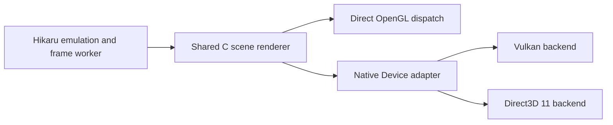

<!-- Portions Copyright 2026 The Hollycast Authors -->
# Hikaru renderer optimization parity

Audit date: 2026-11-14. Scope: the current Hikaru OpenGL, Vulkan and Direct3D 11 implementations, including local renderer work after commit `51b7aa3c6`. This is a source inventory and implementation plan, not a new benchmark or a claim that every game renders identically.

## Current result

- Many optimizations already run before the API split. They should be maintained once in that shared layer.
- The backend implementations do not have complete optimization parity. OpenGL and DX11 now implement the same fragment-list semantics as Vulkan, with peeling fallback when lists cannot be used.
- Equivalent behavior does not require identical API calls or allocation strategies. GL's retained packed VBOs, Vulkan's fence-owned streams, and DX11's DISCARD/NO_OVERWRITE streams solve related problems differently.
- The original audit was read-only. The subsequent state-reuse, OpenGL and DX11 fragment-list batches implement the focused improvements recorded below. No Odin code was used or copied.

## Ownership and shared work

OpenGL uses a null native dispatch inside Device::Scope. Vulkan and DX11 install the native Device adapter; they do not replace the shared scene renderer. Hikaru is separate from the Dreamcast/NAOMI PVR pipeline. Metal is outside this audit.

| Shared optimization | Where it applies | Source anchor |
| --- | --- | --- |
| Bounded emulation/render overlap with two reusable frame packets | All three when threading is enabled; direct path when disabled | [frontend.cpp](../../core/hw/hikaru/frontend.cpp), frameSlots, buildFrame and render-frame path around lines 59, 1096, 1225-1270 |
| Correct pause/reset/save/load ownership and queued-frame invalidation | All three | frontend.cpp, drainFrameWorker and state/load paths; [frame_worker.cpp](../../core/hw/hikaru/frame_worker.cpp) |
| Stable translucent triangle ordering and reusable sort/replay scratch | All three in Per Triangle | [hikaru-renderer.c](../../core/hw/hikaru/valkyrie/src/mach/hikaru/hikaru-renderer.c), triangle_view_depth, stable_sort_triangle_refs and draw_sorted_translucent_triangles, lines 3231, 3538, 3944 |
| Ordered compatible runs with up to 16 transform/depth records | All three, subject to backend palette support | hikaru-renderer.c, build_triangle_palette_runs/load_triangle_palette, lines 3880-4068 |
| Texture/shading palettes reduce state changes without changing stable triangle order | Capability gated; see backend matrix | hikaru-renderer.c, texture_palette_supported and upload_texture_palette, lines 3746, 2257 |
| Decoded texture cache with targeted invalidation for overlapping transfers | All three | hikaru-renderer.c, texture lookup and hikaru_renderer_invalidate_texcache, lines 717-929 |
| Retained bitmap textures, conversion scratch and exact source snapshots | All three; unchanged payload skips conversion/upload, while composition state still applies | hikaru-renderer.c, upload_layer, lines 6034-6185 |
| Per-viewport peeling history, batched visibility queries and blend-mode pruning | All three when using the peeling path | hikaru-renderer.c, composite_peel_layers/draw_transparency_peels, lines 4690-4874 |
| Adjacent identical native triangle-draw merging and bounded conversion scratch | Vulkan/DX11 native adapter; GL has its upstream ordered-run/VBO path | [device.cpp](../../core/hw/hikaru/graphics/device.cpp), flushDraw/queueDraw, lines 138-180 |
| Cached native uniforms/lights and packed-layout detection | Vulkan/DX11 native adapter; GL has per-program caches | device.cpp, uniforms/uniform/DrawArrays, lines 197-272, 466-565 |

CPU sorting computes view-space depth; it does not replace the shader's actual vertex transforms. Native adapter optimizations must not be counted as missing GL features when GL avoids the conversion step entirely.

## Backend optimization matrix

Sources: [GL scene renderer](../../core/hw/hikaru/valkyrie/src/mach/hikaru/hikaru-renderer.c), [dispatch](../../core/hw/hikaru/valkyrie/graphics_dispatch.c), [Vulkan](../../core/hw/hikaru/graphics/vulkan.cpp), [DX11](../../core/hw/hikaru/graphics/dx11.cpp), [native shaders](../../core/hw/hikaru/graphics/shaders.cpp). Line numbers describe the original audit snapshot; the subsequent implementation moves some lines, so symbols are the durable anchors.

| Area | OpenGL | Vulkan | DX11 | Parity decision |
| --- | --- | --- | --- | --- |
| Packed mesh vertices | Original 56-byte body, separate byte palette index where used | 60-byte native representation, including float draw index; required vertex formats checked, 128-byte fallback | Same 60-byte native representation | Equivalent compact paths already exist; do not force GL through native expansion |
| Mesh upload streams | Eight 4 MiB chunks, retained VBOs/VAOs; sorted replay consolidates uploads | Mapped per-submission streams, fence recycling, eight batch slots, 256 draws/batch | Dynamic stream with WRITE_NO_OVERWRITE and WRITE_DISCARD on wrap | API-specific lifetime strategy, not missing parity |
| Repeated peel geometry | Existing frame VBOs retain original mesh data | Immutable converted Geometry lookup and per-stream upload offsets | Reuploads into dynamic stream; does not advertise retained Geometry | Previous DX geometry-cache experiment was rejected; any retry needs a new measured reason |
| Unchanged scalar/light constants | Per-linked-program value caches | Last identical Uniforms payload reuses an immutable offset in the active batch; unused metadata owner rank is ignored only for comparison | Separate vertex/pixel change checks skip unchanged uploads | Whole-payload reuse is implemented; DX11 still has finer vertex/pixel-stage separation |
| Unchanged matrix/depth palettes | Cached active prefixes per program | Last identical palette reuses its batch-owned range and descriptor offset | Entire unchanged DrawRecord palette upload skipped | Implemented equivalents; Vulkan reuse resets on batch acquisition or storage replacement |
| Texture/shading mode arrays | Shared per-program active-prefix cache skips identical updates | Same shared cache reduces native Device updates | Same shared cache plus backend unchanged-palette skip | Implemented once in the common C renderer, including shorter-prefix/regrowth semantics |
| Texture/shading palette capability | Desktop GL only, at least 20 fragment texture units; disabled on GLES | Sampler/image limits must fit 16 palette slots plus three auxiliary inputs | Supported by current feature-level-11 backend | Intentional capability differences; scalar fallbacks must stay correct |
| Program/pipeline specialization cache | 256-program LRU and current-program fast hit | 512-pipeline LRU and driver pipeline cache | 512-pixel-shader cache, compiled-code reuse, fixed state-object caches | Caches exist in all three, at different API granularity |
| Same-key lookup shortcut | Current program/variant avoids full cache search | Last map entry bypasses repeated lookup, refreshes recency, and is invalidated before eviction | Last blend/depth/raster/sampler keys avoid repeated map lookup | Implemented equivalents; pipeline object ownership still protects queued draws |
| Shader/pipeline compilation misses | Synchronous GL program creation | Synchronous pipeline creation | Bounded background pixel specialization with an exact generic fallback | Async/prewarm candidate only after measuring compilation stalls |
| Material binding reuse | Texture/sampler bindings and program uniform caches | Eight-entry immutable descriptor ring per batch, dynamic UBO offsets | Cached shader resource/sampler/buffer/state bindings | Equivalent baseline; fresh palette offsets currently restrict Vulkan descriptor hits |
| Constant-stream capability fallback | GL program storage manages uniform state | Dynamic UBO stream uses device alignment limits | 64 KiB streams require Context1, offsetting and constant-buffer NO_OVERWRITE support; legacy updates remain | Keep explicit feature checks; equal optimization intent does not imply identical capability gates |
| Compatible texture updates | Existing texture + TexSubImage where applicable | Existing image + queued transfer staging, fence-retired staging | Existing image + UpdateSubresource | All three already preserve compatible storage |
| Full/scissored color and depth clear | Native GL clear semantics | GPU attachment clears when color mask is full | Native clear or GPU fullscreen clear | Equivalent full-mask paths |
| Channel-masked color clear | Native GPU clear honoring color mask | Cached fullscreen GPU clear with color write mask, typed float/integer output and dynamic scissor; depth uses attachment clear | GPU fullscreen clear with color write mask | Implemented GPU behavior across all three; Vulkan counts affected clears/pixels |
| Ordinary draw/state submission | Driver-managed GL commands | Batches uploads/clears/draws and retires resources on fences; target switches do not force whole-queue waits | Immediate context, broad last-bound-state suppression | Different APIs; transplant the intent, not Vulkan fences into DX/GL |
| Occupancy queries for peeling | Retained per-layer boolean queries on GLES3/desktop GL3.3+; count fallback on GL3.2 | Non-precise occlusion queries, result collection after submission fence | New exact-count query per segment, UINT64 GetData polling | DX boolean-query/pool reuse candidate; Vulkan fallback query pooling also worth measuring |
| Per Pixel algorithm | Fragment lists on desktop GL 4.3; peeling fallback on older GL/GLES or unsupported targets | Fragment lists when supported; depth peeling fallback | Fragment lists on feature-level-11 devices; depth peeling fallback | Same semantics with API-native storage and synchronization |
| Transparent geometry replay | One collection when lists are supported; repeated for peel layers otherwise | One transparent collection per transaction, followed by GPU sort/blend | One transparent collection when supported; repeated for peeling fallback | Avoid repeated layer geometry without changing per-pixel depth ordering |
| Per Pixel storage control | Shared adaptive node-pool policy for lists; retained layer targets/history for fallback | Same shared policy: four blocks, 16-byte nodes, observed peaks/headroom/shrink hysteresis | Same shared node-pool policy plus peeling target/history fallback | CPU parameters and adaptive sizing are shared by all three |
| Short fragment-list resolution | Shared insertion sort for up to eight nodes; merge sort beyond eight | Same shared insertion/merge resolver | Equivalent HLSL eight-node insertion and long merge resolver | Keep blend precision, D24 order and submission ties equivalent |
| Reusing list buffers safely | Retained SSBOs with buffer-update/shader-storage barriers; GL object lifetime protects replacement; failed collection releases storage before peeling | No unchanged-storage startup wait; GPU barriers order reuse; descriptor/storage replacement still retires users | Retained structured UAV buffers; D3D orders reuse and owns submitted resource references | Preserve ownership guarantees using each API's mechanisms |
| Overflow handling | Collection checks overflow before scene-color resolve and releases failed storage before peeling; fallback peeling retains its bounded-layer warning | Collection never commits partial color; overflow/unsupported collection falls back to peeling | Status staging readback before resolve; failed collection leaves scene intact and frees list storage before peeling | All three share transactional collection and the bounded peeling fallback |
| Fragment scene backup/heads clear | GPU head/status clear per collection; full opaque-scene copy only after successful, nonempty collection | Same deferred scene-copy rule and full GPU head/status clears | GPU UAV head/status clears and deferred mip-zero scene copy | Region-based clears/copies need phase measurements before added complexity |
| CPU cost diagnostics | Opt-in actual upload bytes, uniform/palette cache hits, program lookups/compile time, visibility-query allocation/wait and list-counter wait | Existing waits, uploads, descriptors, pools and pipeline counters; texture counters now distinguish actual transfers | Equivalent native upload/cache/compile/query/list-counter counters; async compile results consumed on graphics owner | Comparable categories with API-specific scope; see counter rules below |
| GPU phase diagnostics | Opt-in desktop timer-query ring: frame and list clear/collect/copy/resolve | Frame queries retired by existing submission fences, plus list phase timestamps | Opt-in timestamp/disjoint-query ring: frame and list phases | Nonblocking polling; unavailable/busy samples never become zero-duration measurements |

Key source anchors: GL packed chunks/VAOs at lines 3269, 3373-3402 and upload_vertex_data; GL program/uniform caches at 1424-1605, 2064-2110 and 2257-2277. Vulkan streaming/retirement at 332-435, pipeline at 584-624, fragment pool/timer/collection at 643-930, masked clear at 1083-1099, per-draw uploads/descriptors at 1176-1265. DX state caches at 241-296, compilation at 298-354, capability fallback at 403-417, clears at 506-530, constants/palettes at 551-585, query allocation/results at 632-683.

## Sorting-mode coverage

Frame scheduling, texture/bitmap reuse, ordinary state caches and compact vertex paths benefit all sorting modes where those operations are used. Per Triangle's stable triangle ordering and compatible-run palettes are implemented in the shared C renderer for all three APIs. Per Strip preserves whole-strip ordering. Fragment lists implement Per Pixel sorting; applying that algorithm to Per Triangle or Per Strip would change the selected mode's semantics.

The three desktop list paths now share ordering, blending and adaptive pool semantics. Their peeling fallbacks and GL/GLES still benefit from shared peeling improvements. Opt-in backend counters and GPU timestamps now expose comparable cost categories; performance equality must still be measured rather than inferred from matching feature lists.

## Per Pixel visual and setting semantics

Both algorithms aim to compose transparent surfaces in per-pixel depth order. A higher fragment-list frame rate does not by itself imply reduced visual accuracy. The list path avoids redrawing geometry once per depth layer.

The current implementations are nevertheless not interchangeable in every setting:

- Peeling fallback uses both Maximum Layers and Pixel Buffer Size. The effective layer count may be lower than the selected maximum at high resolution. Deeper fragments can be discarded with a warning.
- Successful Vulkan, OpenGL or DX11 fragment collection is bounded by node capacity and memory budget, not a fixed per-pixel layer count. Maximum Layers remains stored for peeling/fallback, rather than capping a successful fragment list.
- Unsupported GL/Vulkan/DX11 capabilities or targets, or an incomplete collection, use the peeling fallback. Allocation failure disables the list path for that backend instance. Overflow keeps the opaque scene intact before fallback.
- Equivalent results require the same material, family/opaque depth tests, blend rules, depth quantization, equal-depth submission order, coverage/pattern handling and target color precision. These are correctness requirements for any port.
- Fragment-list nodes retain eight-bit RGB/alpha for RGBA8 targets, and ten-bit RGB with eight-bit source alpha for RGB10_A2 targets. The latter uses spare blend-metadata bits to keep each node at 16 bytes; the resolver still quantizes destination alpha to the target's two bits after each blend.
- Desktop GL lists require OpenGL 4.3, six fragment-stage storage-buffer blocks and indexed bindings, and single-sample RGBA8/RGB10_A2 targets. The existing GL minimum, GLES and Apple paths retain peeling. No mobile list support is implied.

Maximum Layers applies to peeling/fallback; Pixel Buffer Size bounds both algorithms. Compare algorithms with sufficient storage and check overflow diagnostics; identical Per Pixel menu selections alone do not guarantee identical retained depth.

## Diagnostic scope

Unset, empty or `0` trace flags keep diagnostics off. `HIKARU_TRACE_TIMING=1`
enables CPU costs; `HIKARU_TRACE_GPU_TIMING=1` also requests GPU timestamps.
No diagnostic clocks or queries are used in ordinary runs. Reports cover
60 presented/rendered frames, with GPU averages divided by each phase's
completed-sample count. A full ring drops the new sample; it never waits.

The frame interval spans submitted render commands, not the whole emulator loop
or pure GPU busy time. CPU submission gaps can be included. GL begins at shared
scene drawing; native backends begin at their first clear/draw. The list phases
sample the first attempted transaction per frame, including failed collection.
Copy/resolve are unavailable for empty or failed collection. Unsupported timers
and missing samples are explicit, rather than a fabricated zero.

Upload bytes count requested payload, excluding driver padding and storage-only
allocation. GL uses individual uniforms/palette arrays; native APIs upload stage
constants and DrawRecord buffers, so their bytes and hit counts need not match.
GL uniform hits count cached groups, DX hits count unchanged draw constants, and
Vulkan counts reused batch ranges. GL masked-clear count is measured, but its
pixel area is unavailable: viewport dimensions are not a valid clear extent.
Query creation counts visibility queries separately from timer objects. Wait
counters measure existing visibility/counter-readback waits; polling timestamp
availability is never charged as a blocking visibility wait. Vulkan additionally
reports submission-fence waits. Compilation timings cover actual program/shader
or pipeline creation in each API; DX async results are attributed when consumed
by the graphics owner. Startup and cache persistence differ between APIs.

## Implementation order

Effort and risk are relative engineering estimates, not calendar promises or measured FPS gains.

| Priority | Work | Effort / risk | Why and required evidence |
| --- | --- | --- | --- |
| 1 (implemented) | Align diagnostics and count expensive paths | Medium / low | Opt-in counters and nonblocking frame/list timestamps now cover all three APIs. GL masked-clear pixel area remains unavailable. Use the shared frontend total for end-to-end comparison |
| 2 (implemented) | Vulkan GPU channel-masked clears | Medium / medium | Remove the verified readback/edit/upload path. Count real usage first. Match GL/DX scissor, offscreen orientation, channel preservation, RGBA8/RGB10A2 rounding, depth-only/depth-write-disabled and following-draw state |
| 3 (implemented) | Vulkan last-pipeline and same-batch constant/palette reuse | Small for pipeline; medium for uploads / medium lifetime risk | Reuse only immutable ranges owned by the current fence-protected batch. Invalidate shortcuts on eviction, slot recycle, resize and layout changes. Measure bytes saved, descriptor hits and total cost; do not replace correctness checks with mutable trust flags |
| 4 (implemented) | Shared C texture/shading palette mode cache | Small / low-medium | Extend the existing per-program prefix cache. This reduces GL driver updates and native Device uniform updates from the same source change. Test unchanged, changed, shorter, regrown and A/B/A program sequences across APIs; preserve GLES fallback |
| 5 | DX occupancy query reuse/boolean results | Small-medium / medium | Reuse only completed queries and maintain FIFO segment ownership. Evaluate boolean results rather than exact counts, preserving timeout/device-error behavior, empty layers and late additional overlap |
| 6 (implemented) | GL and DX11 fragment-list transparency | Large / high | Reuse our independently written semantics and small/large-list rules where practical; backend storage, shader binding and synchronization remain native. Gate capabilities and preserve peeling fallback. Verify all blend modes, equal-depth ties, opaque/family depth, smoke/patterns, long lists, budgets, overflow, resizing, target switches and save/load |
| Conditional | Background/prewarmed specialization outside DX11 | Medium-large / medium-high | First establish pipeline/program creation is causing the observed hitch. Keep exact generic behavior, bounded pending work and safe graphics/context shutdown |
| Conditional | List head-clear and scene-copy reduction | Large / high | GPU timestamps already identify these phases in Vulkan. An in-place/tiled design needs separate capability/lifetime proof; apply the eventual rules to the GL/DX list implementations |

Priorities 2-4 are now implemented in the state-reuse batch. Vulkan telemetry reports uniform/palette uploads, hits and bytes, pipeline lookups/fast hits, and masked clears/pixels. The new cache deliberately retains only the last payload in each active batch; broader lookup tables need separate cost evidence. OpenGL now shares Vulkan's collector/resolver GLSL, fragment ABI and adaptive pool policy through `graphics/fragment_list_shared.h`; API-specific resources, barriers and retirement stay in their own modules. DX11 now translates the same algorithm to HLSL, streams its 32-byte list constants, retains structured buffers, and checks staging status before scene commit. Its list programs are lazy and cached; optional specialization uses an exact collector fallback. The GL helper guard follows [ARB_shader_image_load_store issue 22](https://registry.khronos.org/OpenGL/extensions/ARB/ARB_shader_image_load_store.txt), excluding uncovered helper samples before atomics without requiring GLSL 4.50.

## What should stay different

- GL's original packed VBO path should not be replaced merely to match native PackedVertex.
- Do not reintroduce the rejected DX retained-geometry candidate just because Vulkan advertises supportsGeometryReuse. Its earlier measurement went the wrong way; require a new bottleneck and design before another attempt.
- Vulkan descriptor/fence ownership is necessary there; DX DISCARD/NO_OVERWRITE and GL driver-managed storage must keep their own safety contracts.
- The audited Hikaru DX11/Vulkan targets use a single sample; no MSAA resolve stage was found to port between them.
- Hardware limits justify scalar texture palettes, expanded vertices and peeling fallbacks. They are not missing optimizations when the faster mechanism is unavailable.
- Do not make a single giant backend abstraction to force matching internals. Share scene decisions, data semantics, validation oracles and policies when they are actually common.

## Existing evidence and remaining validation

Source coverage already includes:

- C/OpenGL material, sorting/overflow, program-cache/palette, vertex storage and bitmap upload cases in the Valkyrie tests.
- Native Device adapter validation and conversion cases in tests/hikaru/graphics_device_test.cpp.
- Native Vulkan and DX11 cases, including a direct generic-Vulkan versus DX11 pixel comparison in HikaruVulkanTest.cpp, SpecializedPixelsPalettesAndRetiredBatches. Do not describe this as having no cross-API pixel tests.
- Fragment ordering/ties, all blend modes, long lists, overflow recovery, small-list boundaries and adaptive pool sizing in the Vulkan and DX11 tests; queued target reuse and timestamp retirement in the Vulkan tests. DX11 also covers compile failure, pending specialization and texture-cache changes during collection.

The state-reuse implementation batch passed five CTests (including GL smoke) and 26 native Vulkan/DX11 cases. New coverage includes real linked-program mode-array prefix checks; GPU masked RGBA8/RGB10A2 clears, integer coverage preservation, scissor/depth/query semantics; upload reuse across 768 queued draws and batch rollover; and pipeline eviction with a two-entry test cache. Existing coverage does not establish full C/OpenGL-to-native same-scene/per-pixel equivalence for every Hikaru title or Android device.

The earlier Vulkan wait-reuse A/B used 900 frames of the same Brave Firefighters slot at 4x internal height, volume zero and CPU tracing. Per Pixel changed from 46.42 to 50.97 FPS (18.83 to 16.95 ms renderer draw); Per Triangle stayed near 60 FPS. That is one Vulkan before/after pair, not an OpenGL/DX11 ranking.

The user separately reported that Vulkan Per Pixel can run at higher resolution/frame rate than OpenGL/DX11 in manual play. Preserve this as a user observation, not a controlled three-API result. Check algorithm depth limits and visible effects as well as FPS.

For future parity batches, Terra 6.1 High owns builds and PC testing. Keep live test windows small and normal (640x360 where practical), fullscreen/maximization off, and avoid taking focus. Internal rendering resolution is independent of this presentation window. Preserve Per Triangle, all existing accuracy/game/input/card/state fixes, muted audio and the requested comparison resolution. Use protected state copies, identical scenes/settings and one emulator at a time; implement the batch first, run regression checks together, then collect matched performance/visual evidence.

## State-reuse batch evidence

Delivered Windows candidate: SHA256 AE6B2638724BE0C9326645FC1999E13442FBD64464EE084F7BA8153FFC6F0453. The final implementation avoids an unnecessary pre-comparison Uniforms copy found during head review. The earlier candidate is retained only in local test evidence.

All five CTests and 26 native Vulkan/DX11 checks passed again after that correction. Production BUILD_TESTING, TEST_AUTOMATION and HIKARU_NATIVE_GRAPHICS_TESTS remain off.

The final 900-frame, CPU-traced 4x Per Pixel pair recorded 46.71 to 52.51 FPS and 18.403 to 16.418 ms renderer draw time, with zero fragment overflows. Background CPU preflight differed substantially (baseline samples 24.4/15.5/24.7 percent versus candidate 5.7/5.6/10.6 percent), so this pair does not isolate a causal speedup. Cache counters confirm repeated uploads and pipeline lookups were skipped. The selected gameplay scene logged no masked GPU clears; focused native tests validate that path.

A final 8x Per Triangle baseline completed, but the candidate was refused by the host-load guard; that pair is incomplete. An earlier candidate's complete 8x pair was approximately 39.48 versus 39.89 FPS and does not establish a large gain or validate the final executable's throughput.

Final comparison windows used a 640x360 normal client area with WS_EX_NOACTIVATE on the owned test window. Recorded accepted-run samples remained nonforeground and unmaximized. Earlier rejected, drifting or foreground runs remain in local evidence and are not presented as clean comparisons. No additional retries are required for this batch; further performance conclusions need a quiet, matched workload.

## Next parity stages

1. Implemented — OpenGL fragment lists on explicitly supported devices: carry over the current Vulkan ordering, 16-byte node semantics, short-list/long-list sort, adaptive storage, transactional overflow fallback and safe reuse guarantees. Keep existing GL/GLES peeling support.
2. Implemented — DX11 fragment lists using its native shader/storage/binding model, with the same budgets, ordering, rounding and fallback tests. The CPU parameter ABI and adaptive pool policy are shared across all three.
3. Implemented — comparable opt-in CPU cost categories and nonblocking GPU frame/list measurements across all three APIs. Use identical visible content and sufficient transparency storage; retain the scope differences below.
4. Smaller measured gaps: completed-query reuse/boolean occupancy in native backends, then compilation/prewarm work where traces show first-use stalls.

Each future improvement must record a status for OpenGL, Vulkan and DX11: implemented in shared code, efficient API equivalent, capability fallback, pending port, or measured rejection. Every applicable port needs accuracy/lifetime checks plus a matched cost comparison. Hardware/driver performance may still differ.

## Keeping parity current

Every renderer optimization should update this matrix with one of: shared implementation; API-specific equivalent; capability-gated fallback; measured rejection; or still missing. Record the source owner, regression case and measurement scope. A feature is not at parity just because similarly named flags exist.
